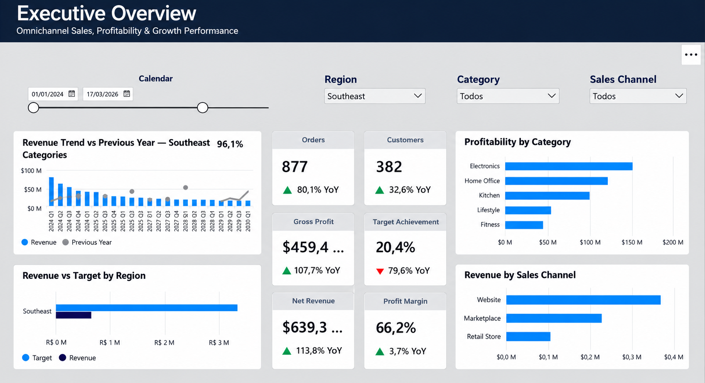

# Vertex Commerce | Omnichannel E-Commerce Analytics

**End-to-end Power BI portfolio project** | Power Query · Data Modeling · DAX · Interactive Reporting

A seven-page Power BI report built for **Vertex Commerce**, a fictional omnichannel retailer. The project transforms intentionally imperfect Excel datasets into an interactive business intelligence solution for exploring **sales, profitability, customer behavior, marketing performance, returns, and regional targets**.

> **Portfolio disclaimer:** This is an independent project using **simulated business data**. Vertex Commerce is fictional; the report does not represent a paid client engagement or real company results.

## Dashboard Preview



*If the preview does not load, upload your screenshot to `images/executive-overview.png` (or change the path above to match your filename).*

## Business Objective

Design a centralized analytics experience that helps stakeholders answer questions such as:

- How are revenue, profit, orders, and customer activity evolving?
- Which categories, products, and sales channels contribute the most to profitability?
- How do customer segments and loyalty tiers differ in value and repeat purchasing?
- How does marketing spend compare with traffic, leads, and revenue?
- Which products and return reasons contribute to refund exposure?
- How does actual regional performance compare with revenue, profit, and order targets?

## Source Data

The Excel source includes six raw tables covering the 2024–2026 reporting period. Records deliberately include data-quality issues for ETL practice.

| Source table | Approx. raw records | Purpose |
| --- | ---: | --- |
| `Raw_Sales` | 8,114 | Order lines, quantities, prices, discounts, channels |
| `Raw_Customers` | 1,800 | Customer attributes, acquisition channels, loyalty tiers |
| `Raw_Products` | 100 | Products, categories, brands, and unit costs |
| `Raw_Returns` | 528 | Returned items, refunds, and return reasons |
| `Raw_Marketing` | 800 | Monthly campaign spend, impressions, clicks, and leads |
| `Raw_Targets` | 160 | Monthly regional sales, profit, and order targets |

Approximate row counts refer to the **original simulated source**. Duplicate records are intentionally present in sales and returns, so cleaned row counts differ.

## Data Preparation — Power Query

The ETL workflow included:

1. Importing and profiling six Excel data sources.
2. Removing duplicate records using the appropriate **line/return IDs**, rather than deduplicating valid multi-item orders.
3. Standardizing regions, channels, categories, and other categorical values.
4. Converting mixed-format dates and numeric fields stored as text.
5. Normalizing percentage discounts and monetary values.
6. Handling missing attributes without inventing source information.
7. Validating keys, data types, and relationships before loading the model.

The raw Excel sheets were preserved separately from the transformed Power BI queries.

## Data Model

The report uses a dimensional approach with these core tables:

- **Facts:** `FactSales`, `FactReturns`, `FactMarketing`, `FactTargets`
- **Dimensions:** `DimDate`, `DimCustomer`, `DimProduct`, `DimRegion`, and marketing-channel dimension where applicable

The calendar dimension supports time-intelligence analysis. Shared dimensions are used to filter related facts; sales and returns are analyzed at their respective transaction/date granularities, while marketing and targets are recorded monthly.


## DAX & KPIs

Measures span several business areas:

| Area | Example metrics |
| --- | --- |
| Sales | Total Revenue, Net Revenue, Orders, Units Sold, Average Order Value |
| Profitability | COGS, Gross Profit, Profit Margin %, Profit After Marketing |
| Customers | Active Customers, Revenue per Customer, Repeat Customers, Repeat Purchase Rate |
| Marketing | Marketing Spend, ROAS, CPC, CPL, CTR, Lead Conversion Rate |
| Returns | Refund Amount, Returned Units, Return Rate % |
| Targets | Revenue/Profit/Order Target Achievement and Variance |
| Time intelligence | YTD, Previous Year, YoY %, MoM %, Rolling 12-Month Revenue |

## Report Pages

| Page | What it provides |
| --- | --- |
| **01 · Executive Overview** | Executive KPIs, trends, category profitability, sales-channel and regional performance |
| **02 · Sales & Profitability** | Revenue and gross profit, margin analysis, profitability bridge, product/category breakdowns, decomposition tree |
| **03 · Customer Analytics** | Active and returning customers, loyalty tiers, segments, customer value, repeat purchase indicators |
| **04 · Marketing Performance** | Channel spend, ROAS proxy, CPC, CPL, CTR, leads, and campaign efficiency |
| **05 · Return & Quality** | Refund exposure, returned units, reasons, product-level return analysis, net revenue |
| **06 · Regional Targets** | Actuals versus monthly targets, achievement ratios, regional variances |
| **07 · Product Detail** | Product-level drill-through with KPIs, trends, sales channels, regions, and return reasons |

### Additional Screenshots

- [Sales & Profitability](images/sales-profitability.png)
- [Customer Analytics](images/customer-analytics.png)
- [Marketing Performance](images/marketing-performance.png)
- [Returns & Quality](images/returns-quality.png)
- [Regional Targets](images/regional-targets.png)
- [Product Detail](images/product-detail.png)

## Interactivity & User Experience

- Date, region, category, channel, and segment slicers where relevant
- KPI cards and visuals that respond to filter context
- DAX-based time comparisons and dynamic titles
- Field parameters for exploring different measures and dimensions
- Decomposition tree, waterfall chart, and detailed matrices
- **Drill-through navigation** from product analysis to Product Detail

## Analytical Use Cases

This report is designed to support decisions such as:

- Comparing revenue growth with profit growth to identify margin pressure
- Investigating categories with strong sales but weaker profitability
- Identifying products with higher return volumes or refund exposure
- Comparing acquisition-channel performance while accounting for attribution limitations
- Exploring customer retention and differences between loyalty segments
- Investigating differences between actual performance and simulated targets

## Important Measurement Notes

- **Simulated data:** All transactions, customers, campaigns, and targets are fictional; findings should not be presented as real-world business outcomes.
- **Marketing attribution:** The source does not link individual orders to specific campaign IDs. Channel-level revenue-to-spend comparisons are **indicative proxies**, not proven campaign-level or incremental advertising ROAS.
- **Return rate:** When sliced by calendar date, returns are recorded by **return date**, while sales are recorded by **order date**. A period-based return-to-sales ratio is not the same as the lifetime return rate for orders placed in that period.
- **Targets:** Monthly targets are independently simulated and can differ substantially from actual sales. Variances should be interpreted in that context.
- **Filters:** The values displayed in screenshots may reflect selected categories, regions, or periods rather than the company-wide total.

## Repository Structure

```text
vertex-commerce-power-bi/
├── README.md
├── Vertex_Commerce_Analytics.pbix
├── dataset/
│   └── powerbi_ecommerce_portfolio_raw.xlsx
└── images/
    ├── executive-overview.png
    ├── sales-profitability.png
    ├── customer-analytics.png
    ├── marketing-performance.png
    ├── returns-quality.png
    ├── regional-targets.png
    ├── product-detail.png
    └── data-model.png
```

*The filenames above are a suggested organization. Update this README if your uploaded files use different names.*

## How to Explore the Project

1. Download or clone this repository.
2. Open `Vertex_Commerce_Analytics.pbix` in **Power BI Desktop**.
3. If prompted, update the Excel source path in **Transform data → Data source settings** to the location of the workbook inside `dataset/`.
4. Select **Refresh** to load data from the local Excel file.
5. Navigate through the report pages, test slicers, and use **Drill-through → Product Detail** from a product visual.

> An exported `.pbix` is intended for Power BI Desktop. Repository screenshots provide a preview without requiring Power BI.

## Skills Demonstrated

**Power BI · Power Query (M) · DAX · Star-Schema Modeling · Data Cleaning · Data Quality · Time Intelligence · KPI Design · Interactive Data Visualization · Business Analysis**

---

**Project type:** Personal portfolio case study · **Data:** Simulated / fictional
